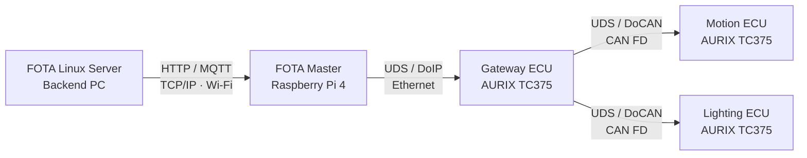
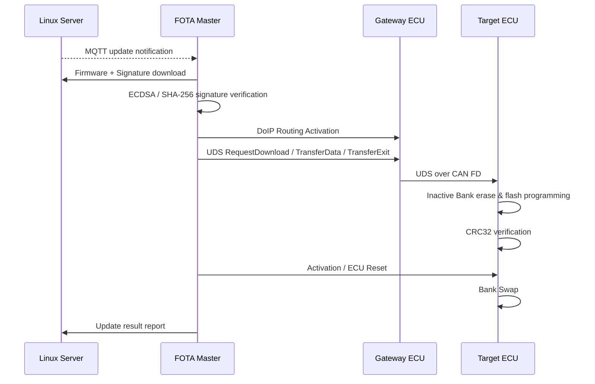

# 🚗 FOTA Reprogramming System

> **차량용 FOTA(Firmware Over-The-Air) 전체 흐름을 구현한 임베디드 통신 시스템 프로젝트**  
> 현대오토에버 모빌리티 SW 스쿨 3기 · 임베디드 6기 / Team Fibonacci

이 저장소는 차량 외부의 Linux 서버에서 시작해 차량 내부 ECU의 펌웨어를 무선으로 배포하고, 검증·전송·Flash 기록·활성화·Rollback까지 수행하는 **FOTA reprogramming 학습용 시스템**입니다.

프로젝트는 Backend Server, Raspberry Pi 4 기반 FOTA Master, Infineon AURIX TC375 Gateway ECU, Motion ECU, Lighting ECU로 구성되며, 서버와 Master 사이에는 HTTP/MQTT, Master와 Gateway 사이에는 DoIP/Ethernet, Gateway와 Target ECU 사이에는 UDS over CAN FD 구조를 사용합니다.

> 본 구현은 AUTOSAR 구조와 차량 진단 프로토콜을 참고한 학습용 구현이며, 상용 AUTOSAR 스택의 완전한 표준 준수를 의미하지 않습니다.

---

## 📌 Project Overview

프로젝트의 목표는 **OTA 시스템의 전체 파이프라인을 실제 ECU 환경에서 연결하는 것**입니다.

- 서버에서 신규 펌웨어 및 서명 파일 관리
- MQTT 기반 업데이트 이벤트 전달
- Raspberry Pi FOTA Master에서 펌웨어 다운로드 및 전자서명 검증
- DoIP(ISO 13400) / UDS(ISO 14229) 기반 진단 통신
- Gateway ECU의 Ethernet ↔ CAN FD 진단 메시지 라우팅
- Target ECU의 Inactive Bank Flash Programming
- CRC32 기반 이미지 검증
- A/B Bank Swap 기반 활성화 및 Rollback
- 업데이트 결과 서버 보고

프로젝트에서 업데이트 대상으로 구현한 Application은 다음과 같습니다.

- **Motion ECU**: 조이스틱 기반 모터 제어 및 가속 제어 로직
- **Lighting ECU**: 수동 스위치 기반 조명 제어 / 조도 센서 기반 자동 조명 제어

---

## 🏗 System Architecture



### Node Responsibilities

| Component | 역할 | 주요 기술 |
|---|---|---|
| `FOTA_Linux_Server` | 펌웨어 버전 관리, 파일 업로드/배포, 서명 생성, OTA 상태 관리 | C, HTTP, MQTT, OpenSSL, Flask |
| `FOTA_Master_RPI4` | 업데이트 이벤트 수신, 파일 다운로드, 서명 검증, UDS/DoIP 업데이트 시퀀스 수행 | C++, Raspberry Pi 4, HTTP, MQTT, OpenSSL, DoIP, UDS |
| `Ecu_Gateway_TC375_LK` | Ethernet 기반 DoIP 메시지를 CAN FD 진단 PDU로 변환·라우팅 | AURIX TC375, LwIP, DoIP, PduR, CanTp, CAN FD |
| `Ecu_Motion_TC375_LK` | FOTA Target ECU + 모터 제어 Application | AURIX TC375, UDS, Flash, A/B Bank, PWM, ADC |
| `Ecu_Lighting_TC375_LK` | FOTA Target ECU + 조명 제어 Application | AURIX TC375, UDS, Flash, A/B Bank, PWM, ADC |

---

## 🔄 FOTA Update Flow



### Main Update Sequence

1. Backend Server에 새로운 펌웨어가 등록됩니다.
2. 서버는 MQTT `ota/update` 메시지를 통해 업데이트 발생을 FOTA Master에 알립니다.
3. FOTA Master는 HTTP로 펌웨어와 `.sig` 파일을 다운로드합니다.
4. Master는 OpenSSL을 이용해 SHA-256 기반 ECDSA 전자서명을 검증합니다.
5. Master는 Gateway ECU와 DoIP 연결을 수립하고 UDS reprogramming sequence를 시작합니다.
6. Gateway ECU는 DoIP Diagnostic Message의 Target Address를 기준으로 CAN 경로를 선택합니다.
7. Target ECU는 `TransferData` payload를 chunk 단위로 수신하여 Inactive Bank에 기록합니다.
8. 전송이 완료되면 CRC32로 기록된 이미지의 무결성을 검증합니다.
9. 검증 성공 시 Swap Entry를 설정하고 ECU Reset 이후 새로운 Bank를 활성화합니다.
10. 필요 시 이전 Bank로 Rollback할 수 있도록 복구 경로를 구성합니다.

---

## 🔐 Firmware Verification

FOTA Master에서는 다운로드된 펌웨어와 서명 파일을 검증한 뒤 ECU 전송을 시작합니다.

```text
Firmware (.bin)
      │
      ├─ SHA-256 Digest
      │
Signature (.sig) + Public Key
      │
      └─ ECDSA Verification
             │
         Verification OK
             │
         UDS Transfer
```

- Server: OpenSSL 기반 SHA-256 및 서명 파일 생성
- Master: `EVP_DigestVerify*()` 기반 ECDSA 서명 검증
- Target ECU: Flash 기록 이후 CRC32 이미지 검증

---

## 📡 Communication Stack

Gateway와 Target ECU는 계층별 역할을 분리한 AUTOSAR-like Communication Stack 구조를 사용합니다.

```text
                    Gateway ECU
                 ┌───────────────┐
Ethernet / TCP → │ SoAd          │
                 │ DoIP          │
                 │ PduR          │
                 │ CanTp         │
                 │ CanIf / CAN   │
                 └──────┬────────┘
                        │ CAN FD
                        ▼
                 ┌───────────────┐
                 │ CAN / CanIf   │
                 │ CanTp         │
                 │ PduR          │
                 │ Dcm (UDS)     │
                 │ FOTA Handler  │
                 └───────────────┘
                    Target ECU
```

- **DoIP**: Ethernet 기반 Diagnostic Message 처리
- **PduR**: PDU ID 기반 통신 경로 선택
- **CanTp**: UDS payload의 CAN FD 분할 및 재조립
- **Dcm**: UDS Diagnostic Service 처리
- **FOTA Handler**: 다운로드·전송·검증·활성화 상태 관리

---

## 💾 Reprogramming & A/B Bank

Target ECU는 실행 중인 Active Bank를 보호하고 반대편 Inactive Bank에 신규 이미지를 기록합니다.

- Inactive PFlash Bank 선택
- Sector Erase
- 수신 Chunk 기반 Flash Write
- 32-byte Page Programming
- CRC32 검증
- UCB_SWAP 기반 Bank Swap 설정
- ECU Reset 후 신규 Bank 활성화
- Rollback 요청 시 이전 Bank 복귀

프로젝트에서는 linker fixed vector 영역과 PF0 alias 영역을 조정하여 업데이트 이미지 전송 범위를 줄이는 방식도 적용했습니다.

---

## 🧠 FOTA Master State Machine


주요 상태:

`OFF → IDLE → WAIT → READY → DOWNLOAD → VERIFICATION → INSTALL → WAIT_ACTIVATION → ACTIVATION`

업데이트 연기 시 `PENDING`, 설치 실패 및 복구 판단 시 `RECOVERY` 상태로 전이합니다.

---

## 📂 Repository Structure

현재 저장소는 시스템 노드 단위로 분리되어 있습니다.

```text
fota-reprogramming/
├── FOTA_Linux_Server/             # 차량 외부 OTA Backend Server
│   ├── src/                       # HTTP, MQTT, OTA, crypto, logging
│   ├── includes/
│   ├── dashboard/                 # Flask 기반 관리 화면
│   └── Makefile
│
├── FOTA_Master_RPI4/              # 차량 측 FOTA Master / DoIP Tester
│   ├── main.cpp
│   ├── ota_comm.cpp               # HTTP/MQTT, update queue, 상태 관리
│   ├── ota_security.cpp           # ECDSA/SHA-256 서명 검증
│   ├── ota_uds_engine.cpp         # DoIP/UDS reprogramming sequence
│   ├── ecu_versions.json          # ECU별 현재 버전 정보
│   ├── public.pem                 # 펌웨어 검증용 공개키
│   ├── lcd/                       # 업데이트 상태/사용자 입력 UI
│   └── Makefile
│
├── Ecu_Gateway_TC375_LK/          # DoIP ↔ CAN FD Gateway ECU
│   ├── Basics/ComStack/
│   │   ├── SoAd/
│   │   ├── DoIP/
│   │   ├── PduR/
│   │   ├── CanTp/
│   │   ├── CanIf/
│   │   └── Can/
│   └── Cpu0_Main.c
│
├── Ecu_Motion_TC375_LK/           # Motion Target ECU
│   ├── Apps/                      # Motor control application
│   ├── Basics/ComStack/           # CAN/UDS communication
│   ├── Basics/Reprogram/          # Flash, CRC, Swap, FOTA Handler
│   └── Cpu0_Main.c
│
├── Ecu_Lighting_TC375_LK/         # Lighting Target ECU
│   ├── Apps/                      # Lamp control application
│   ├── Basics/ComStack/           # CAN/UDS communication
│   ├── Basics/Reprogram/          # Flash, CRC, Swap, FOTA Handler
│   └── Cpu0_Main.c
│
└── docs/                          # 구조·프로토콜·Flash·디버깅 상세 문서
```

현재 최상위 폴더가 실제 시스템 노드의 책임과 일치하기 때문에 별도의 상위 폴더로 다시 이동하지 않았습니다. ECU 프로젝트 내부에는 Infineon 프로젝트 구조, linker/startup 설정, vendor library가 포함되어 있어 경로 변경 시 빌드 설정에 영향을 줄 수 있습니다.

---

## 🔎 Key Source Files

| 파일 | 설명 |
|---|---|
| `FOTA_Linux_Server/src/server.c` | HTTP 요청 처리, 펌웨어 업로드 및 OTA API |
| `FOTA_Linux_Server/src/ota.c` | ECU 버전 비교 및 업데이트 응답 생성 |
| `FOTA_Linux_Server/src/mqtt_handler.c` | 업데이트 이벤트 MQTT publish |
| `FOTA_Linux_Server/src/crypto.c` | SHA-256 계산 및 OpenSSL 서명 생성 |
| `FOTA_Master_RPI4/ota_comm.cpp` | HTTP 다운로드, MQTT 수신, 업데이트 큐 및 OTA 상태 흐름 |
| `FOTA_Master_RPI4/ota_security.cpp` | 펌웨어 전자서명 검증 |
| `FOTA_Master_RPI4/ota_uds_engine.cpp` | DoIP packet 구성 및 UDS reprogramming sequence |
| `Ecu_Gateway_TC375_LK/Basics/ComStack/DoIP/` | DoIP Routing Activation 및 Diagnostic Message 처리 |
| `Ecu_Gateway_TC375_LK/Basics/ComStack/PduR/` | PDU ID 기반 DoIP ↔ CanTp 라우팅 |
| `Ecu_Gateway_TC375_LK/Basics/ComStack/CanTp/` | CAN FD 기반 멀티프레임 전송/재조립 |
| `Ecu_Motion_TC375_LK/Basics/Reprogram/` | Target ECU Flash programming, CRC, Bank Swap, FOTA 상태 처리 |
| `Ecu_Lighting_TC375_LK/Basics/Reprogram/` | Target ECU Flash programming, CRC, Bank Swap, FOTA 상태 처리 |
| `Ecu_Motion_TC375_LK/Apps/accel.c` | Motion ECU 모터 제어 Application |
| `Ecu_Lighting_TC375_LK/Apps/App_Lamp.c` | Lighting ECU 수동/자동 조명 제어 Application |

---

## 🧪 Verification

프로젝트에서는 요구사항을 기준으로 다음 단계의 검증 문서를 작성했습니다.

- Scenario Test
- Unit Test
- Integration Test
- System Test
- Acceptance Test

구현 상태와 확인이 필요한 항목은 [`docs/21_requirements_traceability.md`](./docs/21_requirements_traceability.md) 및 [`docs/22_open_issues.md`](./docs/22_open_issues.md)에 정리되어 있습니다.

---

## 📚 Documentation

상세한 코드 구조와 런타임 흐름은 [`docs/README.md`](./docs/README.md)에서 확인할 수 있습니다.

주요 문서:

- [Project Overview](./docs/00_project_overview.md)
- [Repository Structure](./docs/01_repository_structure.md)
- [System Architecture](./docs/02_system_architecture.md)
- [Gateway ECU Architecture](./docs/03_gateway_ecu_architecture.md)
- [RPI FOTA Master Architecture](./docs/07_rpi_fota_master_architecture.md)
- [Communication Stack](./docs/09_communication_stack_management.md)
- [FOTA Update Flow](./docs/15_fota_update_flow.md)
- [Flash Programming](./docs/16_flash_programming.md)
- [Reset / Boot / Bank Swap](./docs/17_reset_boot_bank_swap.md)
- [Requirements Traceability](./docs/21_requirements_traceability.md)
- [Open Issues](./docs/22_open_issues.md)

---

## 🛠 Main Technologies

`C` · `C++` · `Infineon AURIX TC375` · `Raspberry Pi 4` · `CAN FD` · `CanTp` · `UDS` · `DoIP` · `Ethernet` · `LwIP` · `HTTP` · `MQTT` · `OpenSSL` · `ECDSA` · `SHA-256` · `CRC32` · `A/B Bank` · `PFlash`
